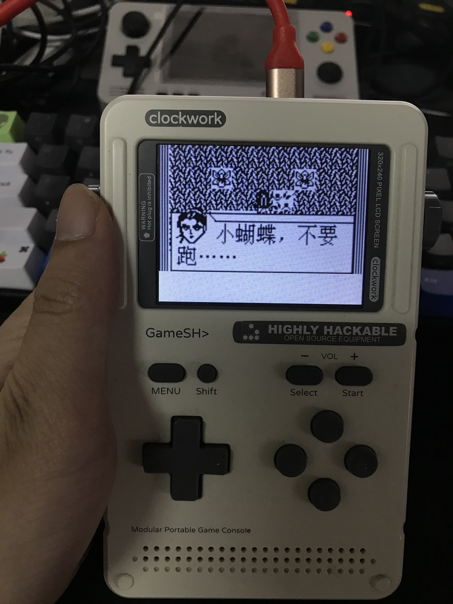
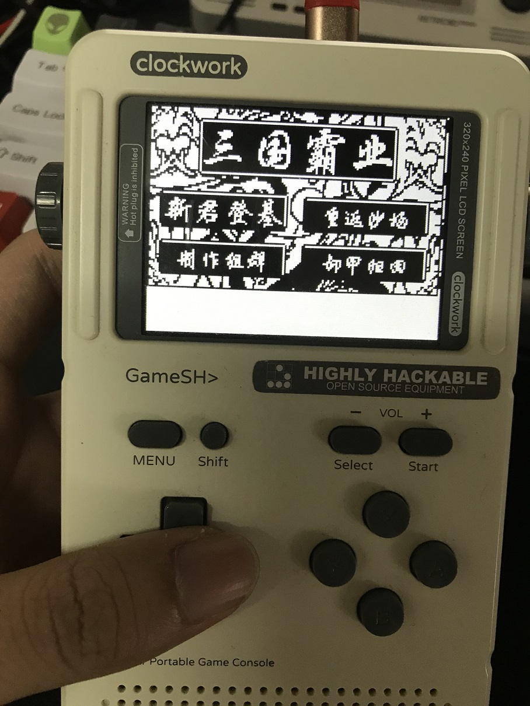

# BBKGames_GameShell
GameShell适配的步步高经典游戏

原项目地址: https://github.com/cyanzhong/bbk.emu

感谢 孤獨愛你 提供的图标资源，更多资源，加QQ群:1041399424

## 一键安装脚本

SSH 连接 GameShell 以后，执行以下命令：

```bash
bash <(curl -sL https://raw.githubusercontent.com/zzxzzk115/BBKGames_GameShell/main/install.sh)
```

GitHub 访问不稳定（比如在中国大陆）时，改用 jsDelivr 获取这个脚本：

```bash
bash <(curl -sL https://cdn.jsdelivr.net/gh/zzxzzk115/BBKGames_GameShell@main/install.sh)
```

脚本会先测一下直连 GitHub 和几个公共 GitHub 代理（ghfast.top、gh-proxy.com、ghproxy.net、gh.ddlc.top）的速度，用最快的那个下载最新的 Release，装到 `~/apps/Menu`。装完刷新菜单即可。想自己指定下载方式，可以设置 `GH_PROXY`（留空表示直连 GitHub）：`GH_PROXY=https://ghfast.top/ bash <(curl -sL …)`。

## 截图

伏魔记:




三国霸业:



